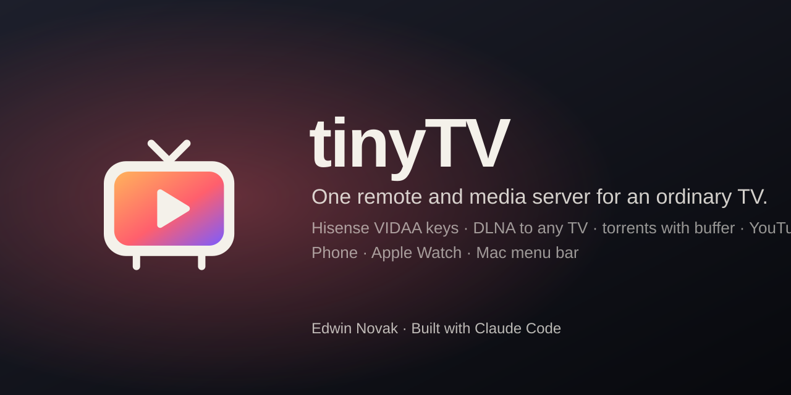

<p align="center"></p>

# tinyTV 0.3.0

**One remote and media server for an ordinary TV.** [Українською ↓](#українською)

Smart TVs without Chromecast or AirPlay are hard to use: one remote for the TV, another app for YouTube, a USB stick for files, and no easy way to play a torrent. tinyTV puts one small server on an always-on Mac and turns your phone, your Apple Watch and your Mac menu bar into the remote for all of it.

> Screenshot placeholders: `docs/screenshots/phone-remote.png`, `docs/screenshots/kino.png`, `docs/screenshots/source-sheet.png`, `docs/screenshots/mac-panel.png`, `docs/screenshots/watch.png`

## What it does

| | |
|---|---|
| **TV keys** | Hisense VIDAA over its local MQTT broker (port 36669): keys, volume, power, apps, Wake-on-LAN. The core finds the TV again by MAC after a router restart |
| **Cast to any TV** | DLNA/UPnP to any TV that is a media renderer; the core serves files with HTTP Range |
| **Torrents** | A magnet plays at once: download in order from the TV's position, "N% ahead" buffer, GPU re-encode (VideoToolbox) when the stream is heavier than the TV's Wi-Fi. Watched torrents are cleaned up unless you keep them |
| **Picture + voice from two sources** | The "Source" sheet: video from one release, the dub from another; the sound is aligned to the picture (`audiosync.py`) and the switch is planned ahead of the buffer, not cut mid-scene |
| **Right episode, right language** | Release names are matched to the episode and the audio language (`tests/match.test.mjs`) |
| **YouTube, files, screen** | yt-dlp; the media library on the core's disks; Mac or core screen on the TV with three latency modes |
| **Watch here** | What plays on the TV also plays in a small always-on-top window on the Mac, or on the phone |
| **Кіно / Discover** | History, bookmarks with resume, lists from IMDb datasets + Wikidata, posters from Wikipedia |
| **Remotes** | `http://tinytv.local` for everyone on the home Wi-Fi, the phone web app, lock screen and Apple Watch (Now Playing), the Mac menu bar panel, Siri Shortcuts; Tailscale for outside home |

Catalog sources and torrent search are **not** part of the core. They are optional providers in [`providers/`](providers/README.md), off by default: `hdrezka`, `trackers`, `tinysearch` (search service + Transmission + MCP connector for coding agents).

## How it fits together

```
 phone / watch / Mac / Siri ──HTTP──►  core on an always-on Mac  ──MQTT TLS :36669──►  Hisense VIDAA
   tinytv.local (:80)                    API :8891, media :8892     ──DLNA──────────────►  any DLNA TV
   Tailscale https :8443 (optional)      engine :8890 (webtorrent)
                                         tinySearch :8896 + Transmission (optional)
```

Details: [ARCHITECTURE.md](ARCHITECTURE.md).

## Install

On the always-on Mac (macOS 14+, Apple silicon):

```bash
./install.sh --dry-run
```

```bash
./install.sh
```

It checks the Mac and the tools, installs what is missing (asks before Homebrew), builds and signs the apps, starts the services, finds the TV (SSDP, then the Hisense port, MAC from ARP) and prints the remote addresses. It is safe to run again and never overwrites your `config.json`. Options: `--with hdrezka,trackers,tinysearch`, `--pair`, `--tailscale`, `--yes`.

Hisense keys need a one-time pairing with a client certificate that is **not** in this repo: [docs/hisense-pairing.md](docs/hisense-pairing.md). Casting works without it.

Something does not work? Ask your coding agent: it reads [AGENTS.md](AGENTS.md) and the skill [skills/tinytv-setup](skills/tinytv-setup/SKILL.md), where every step has a check command and an expected result (TV discovery, static DHCP, DFS Wi-Fi channels, Wake-on-LAN, pairing, Tailscale).

Linux: the engine (`node engine/server.mjs`), DLNA casting and the web pages run; the Swift core and the menu bar app are macOS only for now.

## Develop

```bash
scripts/build.sh
```

```bash
node tests/match.test.mjs
```

```bash
python3 scripts/secret-scan.py .
```

More: [CONTRIBUTING.md](CONTRIBUTING.md), [docs/similar-projects.md](docs/similar-projects.md).

## Status

Personal project, used every day on one Hisense 55A56EEVS. Other VIDAA models and other DLNA TVs should work for casting; key control depends on the TV firmware.

---

## Українською

**Один пульт і медіасервер для звичайного ТВ.**

ТВ без Chromecast і AirPlay незручний: окремий пульт, окремий YouTube, флешка для файлів, і торент не відкрити. tinyTV ставить один маленький сервер на Мак, що завжди увімкнений. Телефон, Apple Watch і панель у рядку меню Мака стають пультом до всього.

**Що вміє**

1. Кнопки Hisense VIDAA через локальний MQTT (порт 36669). Після перезапуску роутера ядро знаходить ТВ за MAC.
2. Трансляція DLNA на будь-який ТВ, що є медіарендерером.
3. Торенти: magnet грає одразу, буфер від секунди ТВ («N% Ahead»), перекодування на GPU для важких файлів.
4. Картинка з одного джерела, озвучка з іншого: звук вирівнюється за картинкою, перехід плануємо наперед.
5. Правильна серія й мова: назви роздач звіряються з серією і мовою звуку (є тести).
6. YouTube, файли з дисків ядра, екран Мака на ТВ, «Дивитись тут» у вікні на Маку чи на телефоні.
7. «Кіно»: історія, закладки з продовженням, «Відкрити» зі списками IMDb і Wikidata.
8. Пульти: `http://tinytv.local` для всіх у домашньому Wi-Fi, телефон, Apple Watch, панель Мака, Siri; Tailscale ззовні.

Джерела каталогів і пошук торентів не входять у ядро. Це окремі плагіни в `providers/`, вимкнені за замовчуванням.

**Встановлення**

1. `./install.sh --dry-run` - подивитися кроки, нічого не змінюючи.
2. `./install.sh` - поставити все. Повторний запуск безпечний, ваш `config.json` не перезаписується.
3. Для кнопок Hisense: спарити за `docs/hisense-pairing.md`, потім `./install.sh --pair`.
4. Щось не працює - попросіть агента прочитати `AGENTS.md`: там кожен крок має команду перевірки й очікуваний результат.

---

MIT © Edwin Novak · Built with [Claude Code](https://claude.com/claude-code)
